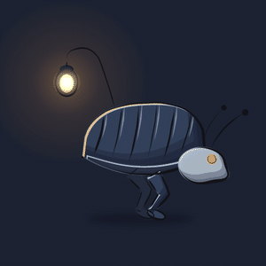
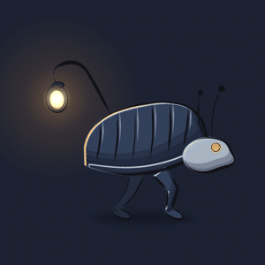

# klad


A 2D art app you share with an AI agent. You draw and paint in the editor with a pen; the agent works on the same drawing through the `klad` command line, and each of you sees the other's changes within a second. Everything in a drawing stays editable: strokes are kept as data (their path, pressure and brush), vector shapes keep their points, and effects, light and depth are settings on layers. klad is source-available, not open source: you can read the code, build it and change it for yourself or inside your company, and send changes back, but not hand out copies of it (see [Licence](#licence)).


It is made for game art: props, characters, backgrounds and frame-by-frame animation, exported as PNGs, sprite sheets or straight into Godot.

## Animation

Drawings live on a timeline, frame by frame: holds, onion skins, loops and clips. Draw the key poses with their parts named and klad makes the drawings in between, paired part by part, while lines drawn by hand stay where they were drawn. It checks the arcs (a foot that slides, a part that sinks under the ground), colours every drawing from the first one, and exports sprite sheets or a Godot `SpriteFrames` scene with each clip's timing.

 

The creature in `samples/creature` is six keys on six layers (lines, colour, a clipped shade and rim light, the far leg, a shadow): an idle and a walk, in-betweened by part, coloured from the first drawing and timed on threes and twos.

```sh
klad inbetween creature.klad --layers lines,colour --from 3 --to 5 --spacing in-out
klad arcs creature.klad --track 'lines:near leg' --clip walk --check
klad export creature.klad --godot ../game/art
```

 

The courier in `samples/courier` is drawn from shapes on every frame: a pose function places the body, legs and lantern, and the CLI fills, lights and inks them on thirteen layers. Its 16 drawings play as an idle and a run at 12 frames a second and export to Godot with that timing.

```sh
klad fill courier.klad flats --shape shell-4 --color shell --frame 4
klad light courier.klad --from shell-4 --light -0.6,-0.8 --shade shade --rim rim --frame 4
klad ink courier.klad lines --from shell-4,head-4,near-leg-4 --weight 5 --frame 4
```

## Status

Early, and open for testing. What works today:

- The `klad` CLI on macOS, Linux and Windows: layers, brush strokes, vector shapes, fills, inking, painting from shapes, light, effects, depth and fog, text in about fifty open fonts that come with it (and any other Google Fonts family on request), frames and clips, in-betweens, exports.
- The editor on macOS, and in a first version on Windows and Linux: a pen with pressure and tilt (pressure only on Windows; on Linux the mouse for now), brushes, layers, masks, a text tool, the timeline, onion skins, notes for the agent, and a start window for new and recent drawings.
- An agent inside the editor (the Agent pane) that works on the open drawing with your Claude API key, so you never need a terminal. Signing in with a ChatGPT account comes later.


## Try it

- macOS and Windows: signed installers will be sold on itch.io and Steam, under the same licence as the source (see [Licence](#licence)). Until then, build klad from source as below.
- Linux: build it from source, free.

Every build holds the `klad` command line tool, the editor, the fonts, the licences and the agent skill (`klad skill` prints it). In the editor, the document menu's "install the klad command" puts `klad` on your terminal's path for you and for agents (`klad install` does the same). The editor checks klad's releases once a day for a new version and says so; it installs nothing by itself (turn it off in the settings window).

### From source

Building takes about ten minutes the first time.

1. Install Rust with [rustup](https://rustup.rs) and [`just`](https://github.com/casey/just) (`brew install just`, or `cargo install just`). On Linux also `pkg-config`, `libfreetype-dev`, `libfontconfig1-dev`, `libxkbcommon-dev` and `libwayland-dev`.
2. `git clone https://github.com/klad-app/klad && cd klad`, then `just build` makes `klad` and `klad-editor` in `target/release/` (on Linux in `target/linux/release/`).
3. `target/release/klad open` starts the editor on its start window: make a drawing and start painting.
4. `just samples` builds the sample drawings in `samples/` (a lantern, a walking creature, a running courier, an underground ruin, an inn sign, a tree, a meadow, painted solids, a bowl of lemons and the same painted over with brushwork, a bouncing ball, ink examples); open one with `target/release/klad open samples/lantern/lantern.klad`.
5. `just app` makes `klad.app` and a disk image on a Mac; `just dist` makes the archive for the machine you are on (`just dist x86_64-pc-windows-msvc` for another target).

## Drawing with an agent

Any coding agent that can run commands (Claude Code, Codex and others) can draw. Give it `docs/skill/SKILL.md` (or the output of `klad skill`) as its instructions (it is written as an agent skill) and the path to a drawing, then ask:

```sh
target/release/klad new art.klad --width 1600 --height 1200 --background '#e9e4da' --sketch
target/release/klad open art.klad    # in another terminal, to watch and draw along
```

> "Block in a rock on the sketch layer, fill it, and paint it as a round form lit from the upper left."

The agent looks at the drawing through renders (`klad render`), changes it with `klad` commands or batches of JSON ops (`klad apply`), and reads what you pinned for it with notes or selected in the editor. Its strokes are marked as agent strokes and every change is one step in the shared history, so you can undo it in the editor.

## Building on it

- `docs/format.md`: the file format of a drawing, enough to read and write one from any program.
- `docs/cli.md`: every command with its options (`klad <command> --help` prints the same).
- `crates/client`: `klad-client`, a small Rust crate that runs klad commands, applies edits as JSON ops and reads drawings back.
- `docs/DESIGN.md`: how klad is built: the CLI, the brush engine, rendering, the editor, the dependencies.
- `CONTRIBUTING.md`: building, testing, the code rules and how to send a change.
- `samples/`: generators that make drawings from scratch, the best place to see the ops in use.

```sh
just build      # release build of the klad CLI and the editor
just test       # every test, and the drawkit check
just lint       # rustfmt and clippy, warnings as errors
just audit      # licences, RustSec advisories, sources, and the notices are current
just samples    # build the sample drawings
```

## Licence

klad is source-available, not open source, copyright Indicode BV.

- The app, meaning everything not listed in the next point, is under the [PolyForm Internal Use License 1.0.0](https://polyformproject.org/licenses/internal-use/1.0.0) with three additional permissions (`LICENSE`): you may use it for your own personal purposes as well as inside your company; you may send changes to Indicode BV to propose them as contributions; and the drawings you make with it are yours to share, with the brush settings and pictures klad copies into them. You may build it and change it for those uses; you may not distribute it, from source or as a build.
- Builds you buy, on itch.io, Steam or from Indicode BV, are licensed under these same terms: one licence for the source and the builds, with no separate end-user licence.
- These files are under the MIT License (`LICENSE-MIT`), so any program or agent can work with klad drawings: `docs/format.md` (the file format), `docs/cli.md` (the command reference), `docs/skill/` (the agent skill) and `crates/client/` (the `klad-client` crate).
- Contributions are licensed to Indicode BV for inclusion in klad and in its sold builds, under the contributor licence agreement (`CLA.md`); see `CONTRIBUTING.md`.

klad is built on open source libraries, fonts and Skia; their licences are in `THIRD-PARTY-NOTICES.md`, also shown by `klad licences` and in the editor's About window.
