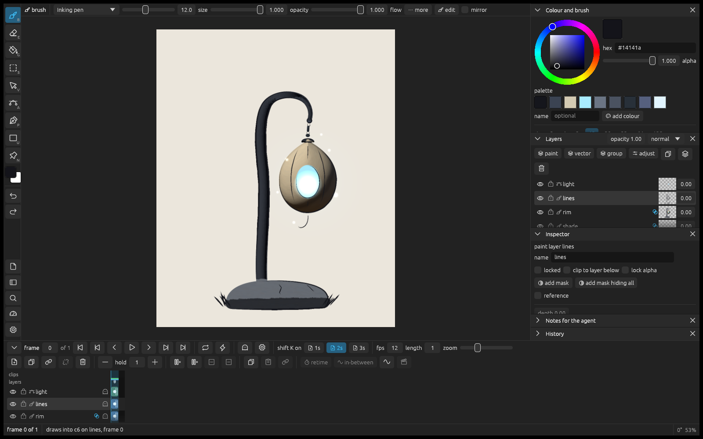
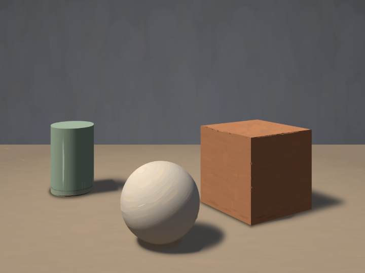
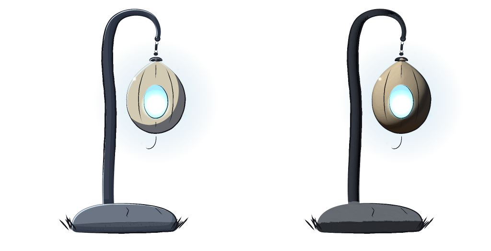
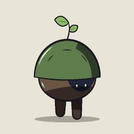
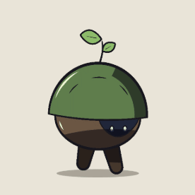
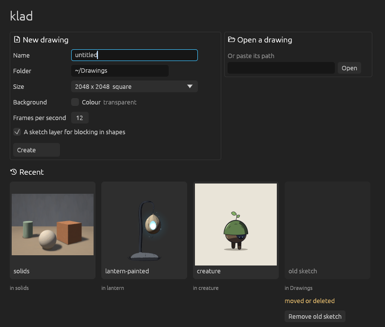

# klad



A 2D art app you share with an AI agent. You draw and paint in the editor with a pen; the agent works on the same drawing through the `klad` command line, and each of you sees the other's changes within a second. Everything in a drawing stays editable: strokes are kept as data (their path, pressure and brush), vector shapes keep their points, and effects, light and depth are settings on layers.





It is made for game art: props, characters, backgrounds and frame-by-frame animation, exported as PNGs, sprite sheets or straight into Godot.

## Animation

Drawings live on a timeline, frame by frame: holds, onion skins, loops and clips. Draw the key poses with their parts named and klad makes the drawings in between, paired part by part, while lines drawn by hand stay where they were drawn. It checks the arcs (a foot that slides, a part that sinks under the ground), colours every drawing from the first one, and exports sprite sheets or a Godot `SpriteFrames` scene with each clip's timing.

 

The creature in `samples/creature` is six keys on six layers (lines, colour, a clipped shade and rim light, the far leg, a shadow): an idle and a walk, in-betweened by part, coloured from the first drawing and timed on threes and twos.

```sh
klad inbetween creature.draw --layers lines,colour --from 3 --to 5 --spacing in-out
klad arcs creature.draw --track 'lines:near leg' --clip walk --check
klad export creature.draw --godot ../game/art
```

## Status

Early, and open for testing. What works today:

- The `klad` CLI on macOS and Linux: layers, brush strokes, vector shapes, fills, inking, painting from shapes, light, effects, depth and fog, text, frames and clips, in-betweens, exports.
- The editor on macOS: a pen with pressure and tilt, brushes, layers, masks, the timeline, onion skins, notes for the agent, and a start window for new and recent drawings.
- Coming next: downloadable builds for macOS, Windows and Linux, the editor on Windows and Linux, and an agent inside the editor you sign in to, so you never need a terminal.



## Try it

There are no downloads yet; build it from source (about ten minutes the first time).

1. Install Rust with [rustup](https://rustup.rs) and [`just`](https://github.com/casey/just) (`brew install just`, or `cargo install just`). On Linux also `pkg-config`, `libfreetype-dev` and `libfontconfig1-dev`.
2. `git clone https://github.com/klad-app/klad && cd klad`, then `just build` makes the `klad` binary in `target/release/` (on Linux in `target/linux/release/`).
3. On a Mac, `target/release/klad open` starts the editor on its start window: make a drawing and start painting.
4. `just samples` builds the sample drawings in `samples/` (a lantern, a walking creature, painted solids, a bouncing ball, ink examples); open one with `target/release/klad open samples/lantern/lantern.draw`.

## Drawing with an agent

Any coding agent that can run commands (Claude Code, Codex and others) can draw. Give it `docs/skill/SKILL.md` as its instructions (it is written as an agent skill) and the path to a drawing, then ask:

```sh
target/release/klad new art.draw --width 1600 --height 1200 --background '#e9e4da' --sketch
target/release/klad open art.draw    # in another terminal, to watch and draw along
```

> "Block in a rock on the sketch layer, fill it, and paint it as a round form lit from the upper left."

The agent looks at the drawing through renders (`klad render`), changes it with `klad` commands or batches of JSON ops (`klad apply`), and reads what you pinned for it with notes or selected in the editor. Its strokes are marked as agent strokes and every change is one step in the shared history, so you can undo it in the editor.

## Building on it

- `docs/DESIGN.md`: the document format, the CLI, the brush engine, rendering, the editor, the dependencies.
- `CONTRIBUTING.md`: building, testing, the code rules and how to send a change.
- `samples/`: generators that make drawings from scratch, the best place to see the ops in use.

```sh
just build      # release build of the klad CLI and the editor
just test       # every test, and the drawkit check
just lint       # rustfmt and clippy, warnings as errors
just audit      # licences, RustSec advisories, sources, and the notices are current
just samples    # build the sample drawings
```

## Licence

Source-available, not open source: the PolyForm Internal Use License 1.0.0 with a personal-use permission, copyright Indicode BV (`LICENSE`). klad is built on open source libraries, fonts and Skia; their licences are in `THIRD-PARTY-NOTICES.md`, also shown by `klad licences` and in the editor's About window.
