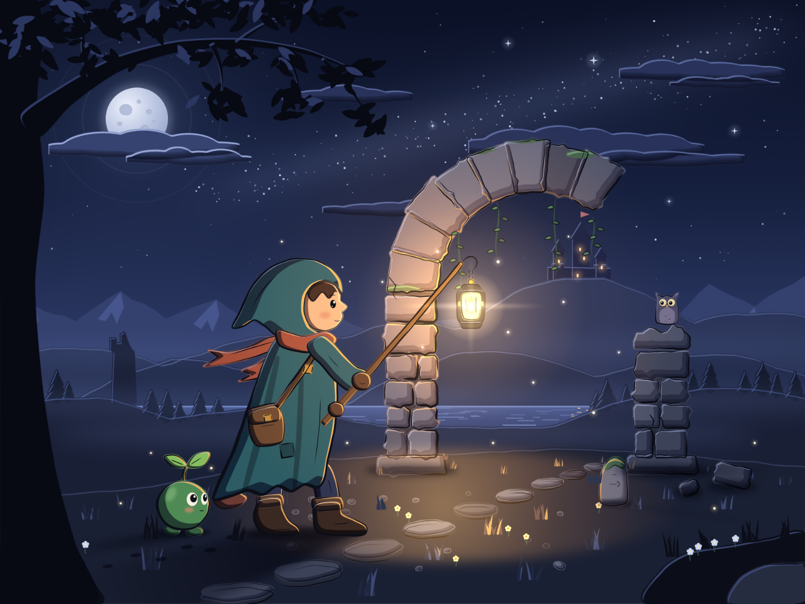
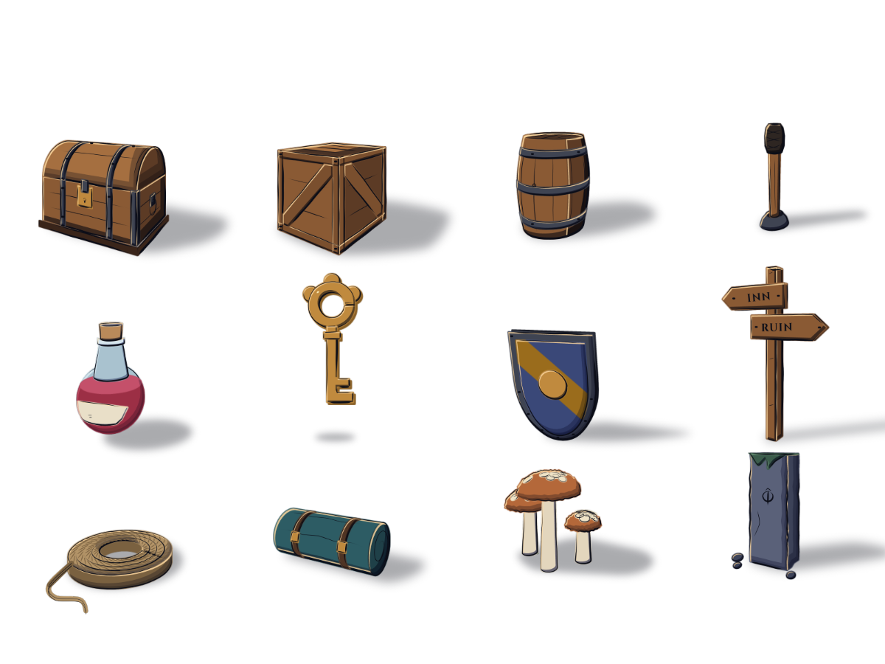
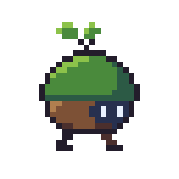
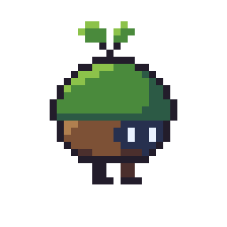
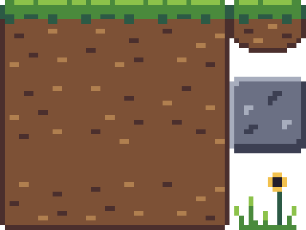

# klad


**Give your agent real brushes.** klad is a 2D painting and animation app you share with a coding agent. You paint in the editor with a pen. The agent paints through the `klad` command line, with the same brushes, on the same drawing, and each of you sees the other's strokes instantly.

*Don't want to build it? Sign up for the pre-built app release at [klad.studio](https://klad.studio).*

**There is no image model in klad.** Your agent (Claude Code, Codex, anything that can run commands) decides what to paint; klad gives it brushes, layers and a timeline. Whatever either of you puts down stays what it was: a stroke with its path, pressure, brush and colour, a shape with its points, a fill with its region. So there's no rerolling and hoping for the best: if one leaf looks off, you fix that leaf.

*Asked for "a little sprout creature for my game", the agent paints 4,344 strokes and fills. You change them: recolour the leaves, bend the mouth, move a smudge, blend the blush. Then the agent animates it: the creature's parts go into five groups, 205 keys move them, and no frame is painted again.*

| | |
|---|---|
|  |  |

*Drawings made with Claude Fable 5.2: the creature, the scene and the prop kit were painted stroke by stroke through the `klad` command line.*

- **Site and guides:** [klad.studio](https://klad.studio), with these drawings replayed stroke by stroke.
- **Made with klad:** made something? [Send it in](https://github.com/klad-app/klad/issues/new?template=made-with-klad.yml) for the gallery on klad.studio.
- **Licence:** source-available, not open source. Free to build and use for yourself, and inside a company with less than 500,000 euros a year in revenue. See [Licence](#licence).
- **Runs on:** macOS, with pen pressure and tilt. It also builds and passes its tests on Linux and Windows, checked on every change: see [What's rough](#whats-rough).
- **Status:** early, and you build it yourself: see [Try it](#try-it).

## Why not just generate the picture?

An image generator hands you pixels, and the only edit left is another roll of the dice. klad keeps every stroke and every fill as data: where it went, how hard it was pressed, its brush and its colour. Pick any of them hours later, yours or the agent's, and recolour it, bend it, move it or delete it.

- **It's paint, not just vectors.** A stroke keeps its path and pressure like a vector does, and still lands as paint. Loaded oil leaves ridges that catch the light, and smudge drags the paint already on the layer. The smudge stays a stroke too: move it later and klad blends it again where it lands.
- **It can also do just vectors.** Shapes with editable points, gradients, glows and real text in about fifty open fonts that come with it, for posters, covers and cards.
- **It's a full painting and animation app.** Two dozen brushes and a brush editor, layers, masks, clipping, effects, a timeline with onion skins and clips, in-betweens made from your key drawings, bones with IK, and exports as PNGs, sprite sheets, GIFs or straight into Godot.
- **It does pixel art on a real grid.** Whole pixels in the colours of a palette, with tiles, palette variants and Aseprite files in and out: see [Pixel art](#pixel-art).
- **Your drawings stay yours.** A drawing is a folder of plain files on your computer, and klad needs no account. It only looks for a new version once a day, and you can turn that off. An edit changes only the files of what it edits, so drawings live well in git.

## Working with your agent

1. **Ask.** Tell your agent what the drawing needs, in plain words: a lantern for the inn, lit from the left, on its own layer.
2. **Watch.** It paints through the `klad` command line, and its strokes show up in your editor as it works.
3. **Point.** Pin a note on the canvas or select the part you mean ("more moss on this side"). The agent reads both.
4. **Take over.** Repaint whatever you like by hand, the agent's strokes as much as your own. Its strokes are marked as its own and every change is one step in a shared history, so you can undo any of it.

The prompt to start with is under [Try it](#then-let-your-agent-paint). klad comes with three agent skills, all in `docs/skill/` and all MIT, so use them with any agent and any tool:

- `klad skill`: the tool. How to look at a drawing, change it and check the result.
- `klad skill drawing`: the craft. Planning a picture, light on form, values, edges, colour, materials and how to judge the result.
- `klad skill pixel`: the same for pixel art, and for animating a sprite.

What an agent paints depends on the agent and on how much you steer it. The skills teach it the tool and some craft; the pen in your hand does the rest.

## For developers: the drawing is data

Everything you can do in the editor has a `klad` command too, so a script or an agent works on the same drawing you have open. It reads strokes as JSON, changes any of them by its address and applies batches of edits as JSON ops.

| To | In the editor | From a script or an agent |
|---|---|---|
| Paint | **B** and a pen with pressure | `klad stroke art.klad l4 --brush oil --path 'M100 400 C 300 200 500 600 700 400'` |
| Change a stroke later | **S** to pick it, then recolour, resize or move; **A** bends its path | `klad set art.klad c4:s12 size=3.5 color=#3355aa` |
| Read what is there | Point at it with **S** | `klad strokes art.klad l4 --json` |
| Flat colour | **G**, filling against the lines layer | `klad fill art.klad l2 --at 820,640 --ref lines --gap 4 --color skin` |
| Pixels | **B** on a pixel layer | `klad pixel sprite.klad l1 --grid sprite.txt` |
| Point at something | **N** pins a note, **S** selects | `klad notes art.klad`, `klad selection art.klad` |
| In-betweens | The in-between window | `klad inbetween art.klad --layers lines,colour --from 0 --to 6` |
| Export | **cmd E**, or export to Godot from a clip | `klad export art.klad --godot ../game/art` |
| Undo | **cmd Z**, or the History pane | `klad undo art.klad` |

The file format is documented down to the byte under the MIT licence (`docs/format.md`), so other apps and engines can read and write klad drawings with or without klad.

## Made for games

Props, characters, backgrounds and frame-by-frame animation. Draw the key poses and klad makes the drawings in between, part by part; it checks the arcs (a foot that slides, a part that sinks under the ground), colours every drawing from the first one, and exports sprite sheets or a Godot `SpriteFrames` scene with each clip's timing.

   

```sh
klad inbetween creature.klad --layers lines,colour --from 3 --to 5 --spacing in-out
klad arcs creature.klad --track 'lines:near leg' --clip walk --check
klad export creature.klad --godot ../game/art
```

## Pixel art

A pixel layer holds whole pixels, each one bound to a palette colour: change the colour and every pixel drawn with it follows. The editor zooms in whole steps, shows a grid between the pixels and keeps a panel with the sprite at its real size.

  

*The pixel samples that come with klad: `sprout`, 32 pixels with a walk and an idle, and `ground`, twelve tiles of 16 pixels.*

- **Draw on the grid.** A pencil and an eraser, fill, rectangles, ellipses and lines, a mirror line, and a box that selects pixels to move, flip, turn or recolour.
- **Shade.** Ramps of five steps, lighter and darker inks that step a pixel along its ramp, dithering, and a one-pixel outline.
- **Animate.** Frames, holds, clips and onion skins. Every frame is a drawing of its own.
- **Recolour.** Palette variants give one sprite several colourings, like a blue team beside a red one.
- **Check.** `klad check` marks stray pixels, doubled corners, jagged lines, banding and colours outside the palette.
- **Bring it in, take it out.** Aseprite files in both directions, pictures turned into pixels, and exports at whole-number sizes that stay sharp: PNGs, sprite sheets, GIFs and a Godot `TileSet`.

An agent draws a sprite from text, one character per pixel, and reads it back the same way:

```sh
klad new sprite.klad --pixel 32x32
klad pixel sprite.klad l1 --grid sprite.txt      # a legend of colours, then rows of characters
klad pixels sprite.klad l1                       # the layer as text again
klad check sprite.klad
klad export sprite.klad --gif --scale 8
klad export ground.klad --tileset ../game/art    # a drawing cut into tiles, as a Godot TileSet
```

The steps in the editor are in [Drawing pixel art](docs/guide/pixel-art.md).

## Try it

There are no installers yet, so you build klad yourself. It takes about ten minutes the first time.

### From source

1. Install Rust with [rustup](https://rustup.rs) and [`just`](https://github.com/casey/just) (`brew install just`, or `cargo install just`). On Linux also `pkg-config`, `libfreetype-dev`, `libfontconfig1-dev`, `libxkbcommon-dev` and `libwayland-dev`.
2. Build it and open the editor:

   ```sh
   git clone https://github.com/klad-app/klad && cd klad
   just compile
   target/release/klad open      # on Linux: target/linux/release/klad open
   ```

   The editor opens on its start window: make a drawing and start painting, open a sample, or take first steps (**Help > First steps**).
3. Put `klad` on your path, for you and for your agent: `target/release/klad install` (on Linux `target/linux/release/klad install`; on a Mac it may ask for your password).

What you build is for your own use, or your company's if it had less than 500,000 euros in revenue last year (see [Licence](#licence)).

### Then let your agent paint

1. Start your coding agent (Claude Code, Codex, or anything else that can run commands) in the folder where the drawing should go, and paste:

   > Run `klad skill` and `klad skill drawing` and read what they print. Then make scene.klad and paint a night scene: a hooded traveller holding a lantern out to a ruined arch, a small creature following, flat shaded and lit by the lantern.

2. Once it has made `scene.klad`, open it in another terminal to watch the strokes land, and draw along: `klad open scene.klad`.
3. Then steer it. Press **N** to pin a note on the canvas ("more moss on this side") and tell the agent to read your notes, or pick any stroke with **S** and change it yourself.

### What comes with it

- **Samples.** Eight drawings to look at and draw on, from a lantern to a walking creature and a pixel art tileset. The start window shows them; `klad samples` lists them and copies one out. `just samples` builds every drawing in `samples/` from its generator; the eight in `samples/shipped.json` go into every build.
- **Guides.** `docs/guide/` shows how to paint, select, fill, draw pixel art, animate, rig and export in the editor, one recipe at a time, starting with [Getting started](docs/guide/getting-started.md).
- **A Mac app.** On a Mac, `just app` makes `klad.app` and a disk image in `dist/`; `just dist` packs this machine's build as an archive. Each machine builds for itself: a Mac builds the Mac version, Linux the Linux one.

## What's rough

- **You build it yourself.** Signed builds for macOS, Windows and Linux are planned, under the same licence as the source; [leave your email on klad.studio](https://klad.studio/pricing) to hear when they are ready.
- **The editor is made on a Mac.** On Linux it starts and you draw with the mouse: tablets give no pressure there yet. On Windows it builds and its tests pass, but nobody has drawn with it there, so tell us what you see.
- **Some illustration basics are missing:** snapping, a grid for shapes, and SVG import and export.
- **Bones are a preview:** their commands may still change.
- **The file format still moves.** Drawings keep opening as klad changes: a new format version comes with a migration.

## Building on it

- `docs/format.md`: the file format of a drawing, enough to read and write one from any program.
- `docs/cli.md`: every command with its options (`klad <command> --help` prints the same).
- `crates/client`: `klad-client`, a small Rust crate that runs klad commands, applies edits as JSON ops and reads drawings back.
- `docs/DESIGN.md`: how klad is built: the CLI, the brush engine, rendering, the editor, the dependencies.
- `CONTRIBUTING.md`: building, testing, the code rules and how to send a change.
- `samples/`: generators that make drawings from scratch, the best place to see the ops in use.

```sh
just compile    # release build of the klad CLI and the editor (plain `just` does the same)
just test       # every test, and the drawkit check
just lint       # rustfmt and clippy, warnings as errors
just audit      # licences, RustSec advisories, sources, and the notices are current
just samples    # build the sample drawings
```

## Licence

klad is source-available, not open source, copyright Indicode BV.

- The app, meaning everything not listed in the next point, is under the [PolyForm Internal Use License 1.0.0](https://polyformproject.org/licenses/internal-use/1.0.0) with three additional permissions and one limit (`LICENSE`): you may use it for your own personal purposes, building it from source free of charge, as well as inside your company; you may send changes to Indicode BV to propose them as contributions; and the drawings you make with it are yours to share, with the brush settings and pictures klad copies into them. The limit: a company (counted with the companies it controls or is controlled by) that had 500,000 euros or more in revenue in its last tax year needs a bought licence for each person who uses klad for it. You may build it and change it for those uses; you may not distribute it, from source or as a build.
- Buying a build, on itch.io, Steam or from Indicode BV, gets you that bought licence, and the build is licensed under these same terms: one licence for the source and the builds, with no separate end-user licence.
- These files are under the MIT License (`LICENSE-MIT`), so any program or agent can work with klad drawings: `docs/format.md` (the file format), `docs/cli.md` (the command reference), `docs/skill/` (the agent skills) and `crates/client/` (the `klad-client` crate).
- Contributions are licensed to Indicode BV for inclusion in klad and in its sold builds, under the contributor licence agreement (`CLA.md`); see `CONTRIBUTING.md`.

klad is built on open source libraries, fonts and Skia; their licences are in `THIRD-PARTY-NOTICES.md`, also shown by `klad licences` and in the editor's About window.
