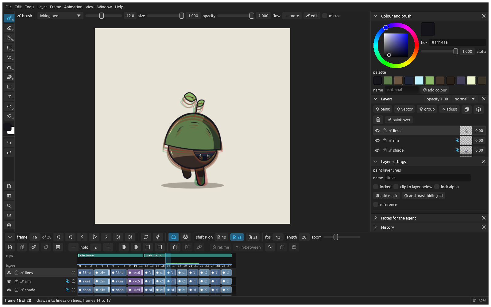

_Last updated: 2026-11-08 14:50_

# Animating frame by frame

Draw an animation one drawing at a time, check it against the drawing before, and play it. klad can draw the in-betweens for you.

## Draw the next frame

1. Draw the first pose.
2. Press **shift K**. You get a blank drawing on the next frame.
3. Press **O** for onion skin: the drawing before shows in red under the one you're drawing.
4. Draw the next pose, and repeat.
5. Press **Return** to play, and again to stop.

To animate on twos, click **2s** next to **shift K on** in the timeline header first.

## Flip through your drawings

Press **,** and **.** to go a frame back and forward. Or hold **Q** and move the pen sideways to flip through the drawings like the corner of a stack of paper.

## Change the timing

Press **=** to hold the drawing under the playhead a frame longer, and **-** to make it a frame shorter. Later drawings move along.

## Start a pose from the last one

Right click the drawing's cell in the timeline and pick **duplicate to the next frame**, then change the copy into the next pose.

## Make clips for a game

Drag along the empty strip above the frame numbers to make a clip, then click its bar to name it (idle, walk, attack). Each clip [exports](exporting.md) as its own animation.

## Let klad draw the in-betweens

1. Draw two keys with empty frames between them, and [name the parts](selecting.md#name-the-parts-of-a-drawing) of both.
2. Click the first key's cell and shift click the second one's.
3. Click **in-between** in the selection bar.
4. Choose how many drawings to make and how they're spaced, and click **make the in-betweens**.

After you change a key, select the range again and click **redo the in-betweens in the selection**.
