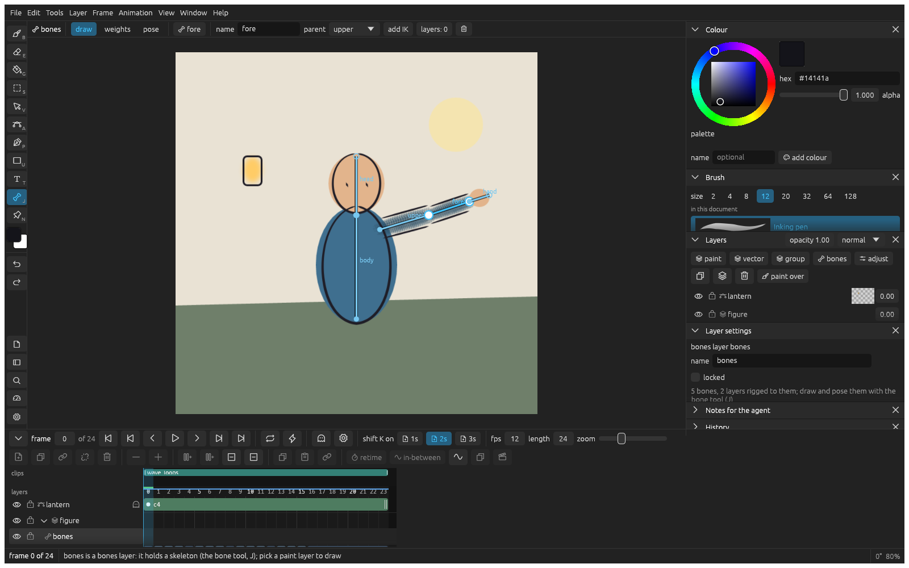

_Last updated: 2026-11-08 14:50_

# Posing with bones

Draw a character once, give it a skeleton and pose it on each frame instead of redrawing it.

## Draw a skeleton

1. Put the character's layers in a group and select the group.
2. Press **J** and pick **draw** in the bar over the canvas.
3. Drag to draw the first bone, click to add the next one, and press **Esc** to end the chain.

Alt drag from a bone's end to start a branch there, such as an arm off the spine.

## Say which bone moves what

1. Pick **weights** in the bar and click **automatic weights**.
2. Cmd click a bone, then paint where it should move the drawing. Alt paints weight away.

Give rigid parts, like a head or a hand, full weight on one bone so they don't bend.

## Pose it

Pick **pose**, go to a frame and drag a bone's end to turn it. Its children follow. Poses in-between on the bones, so a limb swings around its joint instead of sliding.

## Let a leg reach

1. Pick the shin and click **make it a limb with** its parent.
2. In **pose**, drag the shin's end. Both bones turn so the foot lands where you drag.
