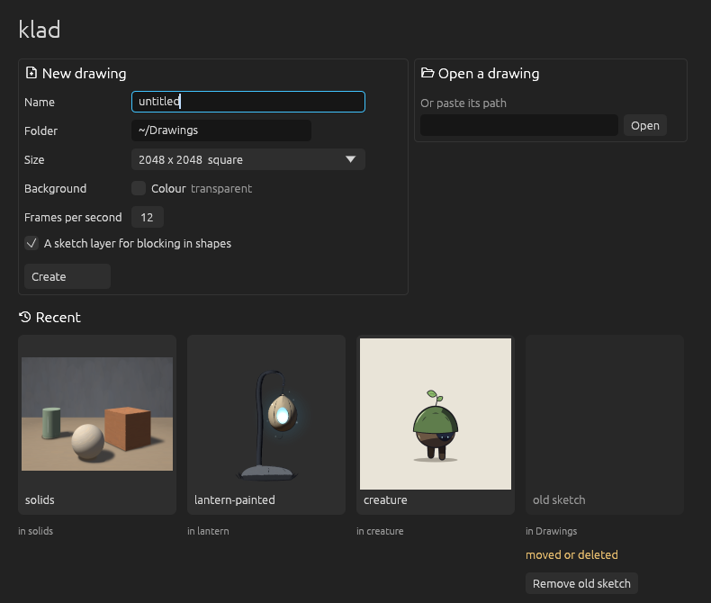

# Getting started

klad is a drawing, painting and animation app. You can do everything in these guides by hand, with a pen or a mouse; an agent is something you add when you want one ([Working with an agent](with-an-agent.md)).

Keys are written the way a Mac shows them. On Windows and Linux, cmd is ctrl.

## Get klad

Signed builds for macOS and Windows will be sold on itch.io and Steam. Until then, and on Linux, [build klad from source](https://github.com/klad-app/klad#from-source); the first build takes about ten minutes. A build holds the editor, the `klad` command line tool, about fifty open fonts and six sample drawings.

The editor is most complete on macOS, where the pen gives pressure and tilt. On Windows it's a first version with pressure but no tilt, and on Linux you draw with the mouse for now.

## Make a drawing

1. Start klad. The start window lists your recent drawings and the samples.
2. Press cmd N, give the drawing a name and pick its folder, size and background.
3. Press B and paint.

There's no save command: every change is written to the drawing as you make it. A drawing is a folder whose name ends in `.klad`, holding plain files, so you can copy it, zip it or put it in a shared folder. cmd W closes it and takes you back to the start window.

To open a sample, click its card. klad copies it into your drawings folder and opens the copy, so the sample stays as it was. Help > First steps walks you through drawing a shape, filling it and handing the drawing to an agent.

## Find your way around

The tools sit in a strip on the left, each with its key letter in the corner. On the right is the dock with its panes: colour and brush, layers, layer settings, notes for the agent, and history. The timeline runs along the bottom, and the status line under it says what just happened and where your next stroke will go ("draws into c12 on lines, frames 4 to 7").

- **cmd K** finds any command: type a few letters of what you want to do. Commands that can't run right now are greyed out, with the reason.
- **?** lists every key. Change them in the settings (cmd ,), under Keys.
- **Tab** hides every panel; **shift Tab** hides only the dock. A pane you closed comes back from the Window menu.

## Move around the canvas

| To | Do |
|---|---|
| Pan | Hold space and drag, or drag with the middle button |
| Zoom | Pinch, or hold cmd and scroll |
| See the whole canvas | F |
| See it at 100% | 1 |
| Turn the view | R and shift R, 15 degrees at a time |
| Check the drawing mirrored | H (the drawing itself doesn't change) |

The zoom in the status line also takes a click for 100% and a double click to fit, and a click on its rotation turns the view upright again.

## Undo

cmd Z undoes and cmd shift Z redoes, whether the change was yours or an agent's. The History pane lists the last hundred steps with who made each one; click a row to go straight back to that point.

## Tune your pen

Open the settings (cmd ,) and the Pen section, then press on the tablet: two bars show the pen's raw pressure and the pressure your strokes record. If your hardest press never reaches full pressure, press as hard as you'd ever draw and click "heaviest = my peak". Lightest sets the raw pressure that counts as the lightest touch, and the curve makes light presses record heavier (below 1) or lighter (above 1).
