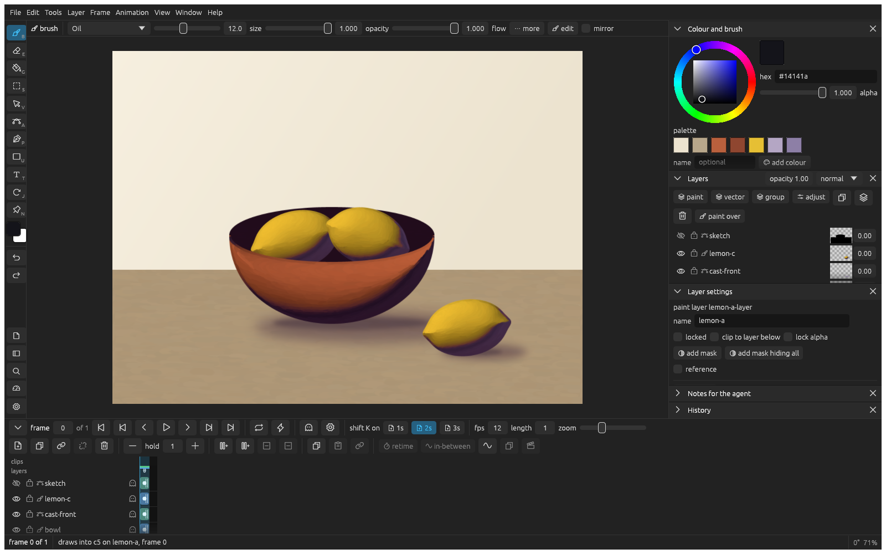
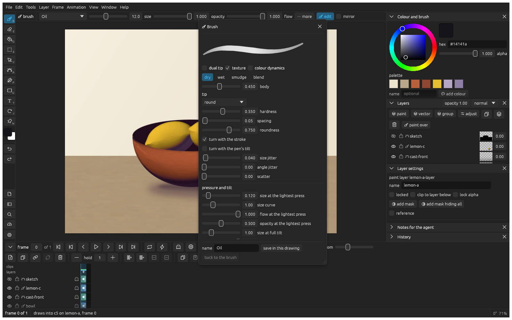

_Last updated: 2026-11-09 21:00_

# Painting

Paint with klad's brushes, blend colours on the canvas and make brushes of your own.

## Paint and erase

Press **B** and paint on a paint layer. **E** switches to the eraser and back, and so does the eraser end of the pen. **[** and **]** make the brush smaller and bigger.

An eraser stroke stays with the strokes it erased, like a mask that travels with them: move them and the cut goes along, without biting into what they land on. Smudges and blends stay with their strokes the same way. [Move an eraser on its own](selecting.md#move-an-eraser-on-its-own) to change that.

## Pick a brush and a colour

Click a brush in the **Brush** pane: Inking pen, Pencil and Marker for lines, Oil, Loaded oil and the bristle brushes for paint. Hold **alt** and click the canvas to pick up a colour from it.

## Blend colours

Paint with **Smudge**, **Wet round** or **Blender** over colours that are already there. They only mix paint on the layer they paint on, so put the colours you want to blend on one layer.

## Make paint look thick

1. Paint with **Oil** or **Loaded oil**.
2. In layer settings, pick **relief** from **add an effect**.
3. Drag on the light dial towards where the light comes from.

## Paint symmetrically

Turn on **mirror** in the brush bar. Every stroke is painted with its mirror image across an upright line.

## Make your own brush

1. Press **F5** to open the brush editor.
2. Change the tip, the pressure or the kind of paint, and watch the sample stroke at the top.
3. Type a name and click **save in this drawing**.

## Tune your pen

1. Open the settings with **cmd ,** and go to **Pen**.
2. Press on the tablet as hard as you ever draw, then click **heaviest = my peak**.
3. If light strokes still come out too heavy, set the curve above 1.
