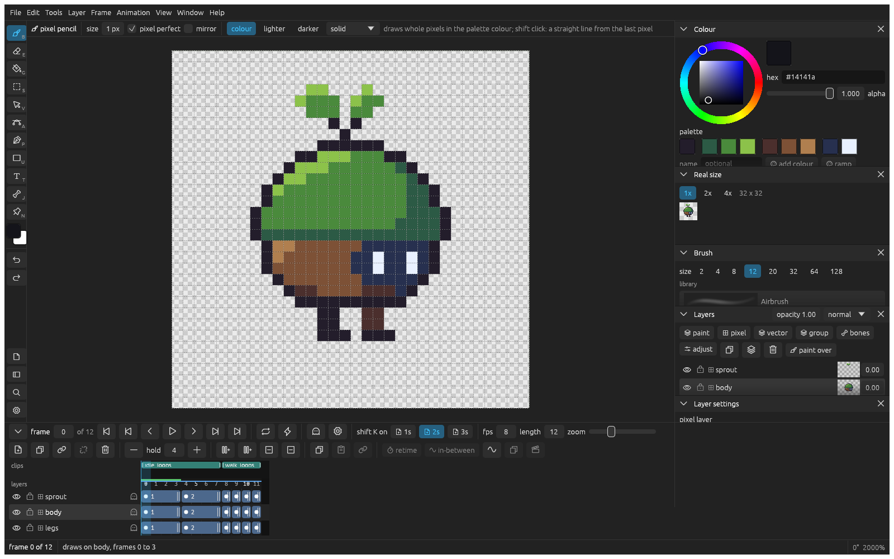

_Last updated: 2026-11-12 23:50_

# Drawing pixel art

Draw sprites and tiles on a grid where one pixel is one pixel, in the colours of a palette, and export them sharp.

## Start a pixel drawing

1. In the start window, select **Pixel art** and choose a size, such as 32 x 32.
2. Click **Create**. The drawing opens enlarged, with a grid between the pixels, and the **Real size** panel shows it at the size it really is.

## Draw and erase

1. Press **B** and draw. Each pixel takes the current colour, and the colour joins the palette.
2. Shift click to draw a straight line from the last pixel.
3. Press **E** and drag to clear pixels.
4. Press **G** and click inside a shape to fill it, or **U** to drag a rectangle, an ellipse or a line.

To change a colour everywhere, click it in the palette, change the colour, and click **update**.

## Shade along a ramp

1. Click a palette colour and click **ramp**. Five steps of it join the palette, dark to light.
2. Draw a shape with the middle step.
3. In the pencil's options, select **darker** or **lighter** and go over the pixels: each one moves a step along its ramp.

## Check your pixels

Select **Layer > Check the pixels**. Single pixels, doubled corners, jagged lines, banding and colours outside the palette get a box on the canvas. The boxes follow your edits; select it again to turn it off.

## Make a tile or a tileset

- For one tile that repeats, select **View > Tile: wrap at the edges**. What you draw past an edge comes back in on the other side.
- For a set of tiles, select **View > Tileset: cut into tiles…**, enter the tile size, and click **cut into tiles**. The canvas shows the tile lines.

## Export it sharp

1. Press **cmd E**.
2. Pick **image**, **GIF**, **sprite sheet** or **Aseprite**.
3. Set **times real size** to a whole number, such as 8, and click **export**.

A tileset goes to Godot with **as a tile set** in the same window. For other colourings of the same sprite, see [palette variants](exporting.md#export-palette-variants).

Working with an agent? Give it `klad skill` and `klad skill pixel`: [With an agent](with-an-agent.md).
