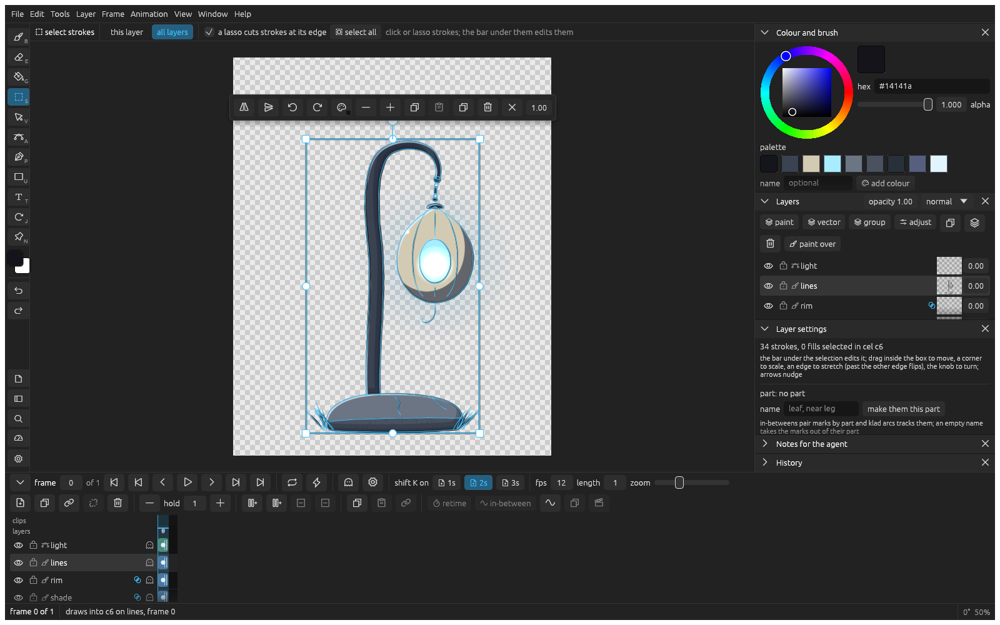

_Last updated: 2026-11-08 14:50_

# Changing strokes

Pick up any stroke or fill, yours or an agent's, and move it, recolour it, bend it or delete it. klad paints it again in its new state.

## Move something

Press **V**, press on what you want to move and drag. Hold **alt** to drag a copy.

## Select strokes

Press **S** and click a stroke. Shift click adds more, and dragging a loop lassoes them. **cmd A** selects everything on the layer at this frame.

To pick on every layer instead of only the active one, switch the bar over the canvas to **all layers**.

## Change what you selected

Drag inside the box to move it, a corner to scale it and the knob to turn it. The bar next to the selection recolours it with the current colour, makes strokes thinner or thicker, duplicates it (**cmd D**) and deletes it (**Backspace**).

## Bend a stroke

1. Press **A** and click the stroke.
2. Drag a point or a handle. The stroke keeps its pressure, so its taper stays where it was.

Alt click on the stroke adds a point.

## Move a whole layer

Press **cmd T** and drag inside the box to move the layer, a corner to scale it or outside it to turn it. It moves every drawing on the layer; switch off **every drawing** to move only this frame's. Press **Return** when you're done.

## Name the parts of a drawing

Select the strokes of one piece, such as a leaf or a leg, type a name under **part** in layer settings and click **make them this part**. [In-betweens](animating.md#let-klad-draw-the-in-betweens) pair strokes by part.
